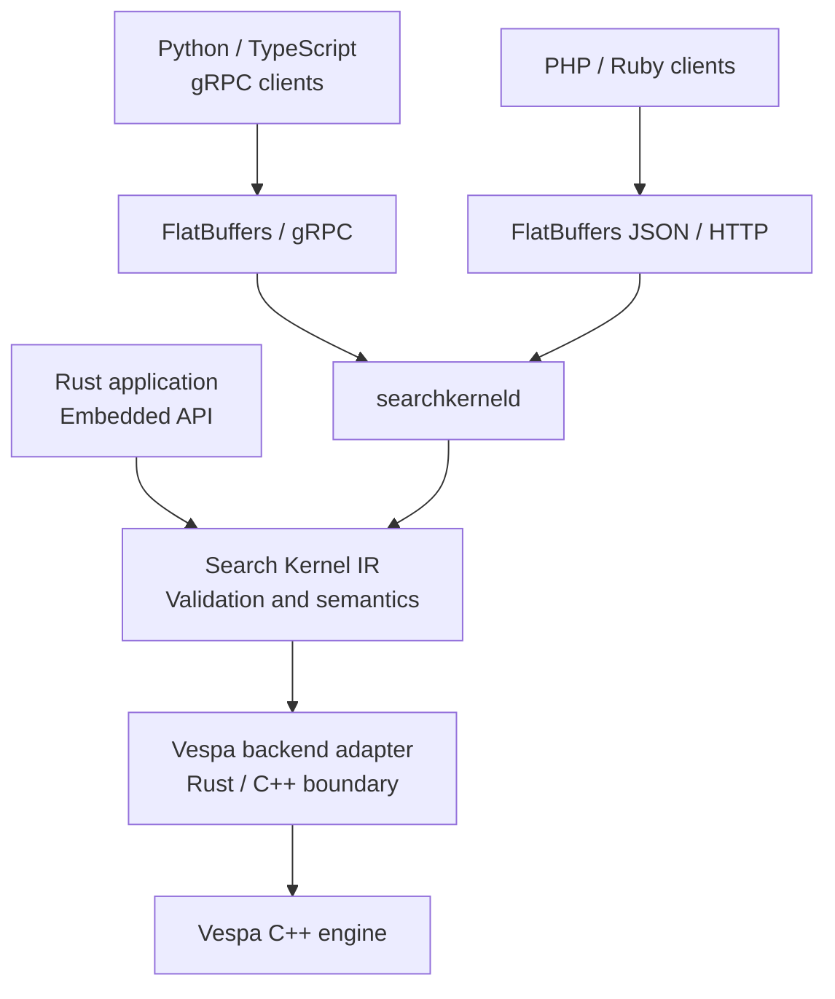

# Search Kernel

Search Kernel is a Rust interface to Vespa's native C++ search engine, packaged so it can be embedded directly in an application instead of run as a separate distributed service.

Vespa's C++ engine does the actual work: storage, indexing, ranking, query execution. Search Kernel does not reimplement any of it. It gives that engine a normal Rust API plus first-party Python, TypeScript, PHP, and Ruby clients through `searchkerneld`. Release qualification is deliberately narrower than implementation presence; see the [release support matrix](docs/release-support.md).

## Why

Running a search cluster to get full-text search, filtering, and ranking is a lot of infrastructure for most applications. Most applications don't need a cluster. They need an index that lives next to their data and behaves like any other embedded store.

Vespa was originally developed at Yahoo and is used for production search and retrieval at companies including Spotify and Perplexity. It's a mature, large-scale search platform, not a standalone library designed to be embedded in applications.

Vespa already solves the hard problems here: ranking, tensors, vector search, index fusion, durability. It solves them at a level of maturity that would take years to reproduce. Search Kernel doesn't try, it makes that battle-tested maturity usable as a library.

## What it is

- **Embedded in Rust.** Rust applications use the engine directly in-process. An index is a directory, not a separate search service.
- **Ergonomic first-party language clients.** Python, TypeScript/Node.js, PHP, and Ruby provide application-facing APIs through `searchkerneld`. Python can also manage the local daemon. PHP is implemented but not yet release-qualified.
- **A familiar search API.** Create indexes, manage documents, and compose searches with filters, sorting, facets, and supported advanced query controls.
- **Mutable, persistent indexes.** Insert, update, and delete documents; close an index and reopen it from disk.
- **Access to Vespa's engine.** Text search, ranking, grouping, and supported vector and geo operations use Vespa's native implementation. The exposed feature set is documented in the [capability ledger](docs/CAPABILITIES.md).

## Making Vespa embeddable

Vespa's C++ engine was built to run inside a much larger search platform, not as a library that arbitrary applications can link and initialize. In a normal deployment, surrounding infrastructure supplies configuration and manages much of the engine's operating environment. Exposing a few C++ entry points is not enough to make it a usable embedded store.

Search Kernel supplies that missing integration: translating application schemas into native configuration, managing engine startup and shutdown, containing native ownership and error boundaries, and making persistent indexes usable through create, update, close, and reopen operations. It also needs to deliver the native runtime reliably, and to verify that requests crossing the Rust and client boundaries still execute with Vespa's intended behavior.

The result spans a C++ adaptation layer, a Rust application API, a multi-index daemon, first-party language clients, and build and verification tooling. The engine still does the searching; Search Kernel makes that engine practical to use outside Vespa's deployment model.

## Start here

Search Kernel is currently a **0.1.x beta**. Consumer installation uses released artifacts; contributor setup is separate.

- [Install the released packages and runtime](docs/getting-started.md#installation-and-runtime-ownership).
- Check the [release support and stability contract](docs/release-support.md) before deployment.
- Follow the [canonical executable release quickstarts](docs/release-quickstart.md).
- See the [release notes](docs/release-notes.md) and [consumer troubleshooting](docs/getting-started.md#troubleshooting).
- Use [BUILDING.md](BUILDING.md) for source builds and contribution setup.

## Rust embedded quickstart (Linux x86-64 glibc)

After the public consumer release is published, install Rust, Python 3, a C/C++
compiler, CMake, Git, and curl. The native Vespa base is downloaded automatically
from the public release; no GitHub login or private token is required.

```bash
tag=v0.1.0
base="https://github.com/superkelvint/searchkernel/releases/download/$tag"
curl -fL "$base/manifest.json" -o manifest.json
python3 - "$base" <<'PY'
import hashlib, json, pathlib, sys, urllib.request
manifest = json.loads(pathlib.Path("manifest.json").read_text())
matches = [a for a in manifest["artifacts"] if a["file"].startswith("searchkernel-rust-")]
if len(matches) != 1:
    raise SystemExit("expected one Rust source bundle in release manifest")
artifact = matches[0]
with urllib.request.urlopen(sys.argv[1] + "/" + artifact["file"]) as response:
    data = response.read()
if hashlib.sha256(data).hexdigest() != artifact["sha256"]:
    raise SystemExit("Rust source bundle checksum mismatch")
pathlib.Path(artifact["file"]).write_bytes(data)
print(artifact["file"])
PY
mkdir searchkernel-release
tar -xzf searchkernel-rust-*.tar.gz -C searchkernel-release
cd searchkernel-release
cargo run --manifest-path release-quickstart/Cargo.toml
```

Success prints `Rust release quickstart PASS` after searching, closing, and
reopening a real Vespa-backed index. The first build downloads a large native
base. This public path is ready for anonymous use once the consumer release
assets are published.

The qualified platform is **Linux x86-64 with glibc**. Supported release modes are Rust embedded, `searchkerneld`, Python managed-local/connect, TypeScript/Node connect, and Ruby connect. Browser gRPC-Web, PHP, Ruby managed-local, Go, macOS, Windows, and Linux aarch64 are deferred.

## Python quickstart

This Python example creates an index, inserts three documents, searches with a filter and sort, then closes and reopens the index. Python's managed-local mode starts and manages a local daemon. Use a fresh `./search-python` directory and install the matching beta release first.

The example follows the [executable release quickstart](docs/release-quickstart.md#python-managed-local).

```python
from pathlib import Path
from searchkernel import Index, Integer, Keyword, Text

path = Path("./search-python")

documents = [
    {"_id": "quickstart-a", "title": "quickstart alpha", "kind": "guide", "score": 2},
    {"_id": "quickstart-b", "title": "quickstart beta", "kind": "guide", "score": 1},
    {"_id": "quickstart-c", "title": "quickstart other", "kind": "other", "score": 0},
]

with Index.create(
    path,
    fields={
        "title": Text(stored=True, searchable=True),
        "kind": Keyword(stored=True, filterable=True),
        "score": Integer(stored=True, sortable=True),
    },
) as index:
    for document in documents:
        index.insert(document)

    hits = (
        index.search("quickstart")
        .filter("kind = 'guide'")
        .sort("score", "asc")
        .execute()
        .hits
    )
    assert [hit.id for hit in hits] == ["quickstart-b", "quickstart-a"]

with Index.open(path) as index:
    assert index.get("quickstart-b")["score"] == 1
    hits = (
        index.search("quickstart")
        .filter("kind = 'guide'")
        .sort("score", "asc")
        .execute()
        .hits
    )
    assert [hit.id for hit in hits] == ["quickstart-b", "quickstart-a"]

print("Search and reopen: PASS")
```

Expected output:

```text
Search and reopen: PASS
```

The [full release quickstarts](docs/release-quickstart.md) cover Rust embedded, Python managed-local, TypeScript/Node connect, and Ruby connect, including search verification after reopen.

## Architecture

Rust applications call the engine directly in-process. Other languages use `searchkerneld`, which manages one or more indexes. Both paths converge on the same semantic layer and Vespa backend.



### Architectural decisions

**Reuse the engine, not its deployment model.** Vespa continues to own indexing, matching, ranking, and persistence. Search Kernel takes on the surrounding integration. This avoids building a second search engine, but retains a substantial native runtime dependency.

**Embed in Rust; share a daemon elsewhere.** Rust applications avoid an RPC round trip. Other languages use `searchkerneld` rather than maintaining separate C++ bindings and engine lifecycles. The tradeoff is a process boundary for those clients.

**Make the APIs ergonomic without splitting their meaning.** Clients expose language-idiomatic search builders and document operations. [FlatBuffers](api/README.md) defines the portable contract, while the shared [IR](core/crates/searchkernel-ir/README.md) owns validation, defaults, and request semantics. Language-specific convenience APIs do not become separate implementations of search behavior.

**Contain the native boundary.** Vespa-specific types stay inside the [C++ adapter](core/native/vespa/README.md); the [Rust engine wrapper](core/crates/searchkernel-vespa-engine/README.md) owns native handles and translates errors. The application API does not need to know Vespa's C++ object model.

**Test the engine behavior, not just successful calls.** [Reference contracts and real-engine verifiers](reference/vespa/) check native behavior against independent expectations. In particular, a correct-looking result is not sufficient evidence that the intended engine execution path ran.

### Explore the implementation

For a closer look at the engineering, these are good starting points:

- [Native C ABI](core/native/vespa/searchkernel_vespa.h) — the boundary between Rust ownership and Vespa's C++ engine.
- [Request resolution](core/crates/searchkernel-ir/src/api_to_ir/resolve/mod.rs) — validation and normalization into shared semantic IR.
- [Canonical dispatcher](core/crates/searchkernel-dispatch/src/lib.rs) — transport-independent execution of portable requests.
- [Real-engine verification](reference/vespa/m14/verify-m14.sh) — cumulative native tests and direct Vespa behavior checks for nearest-neighbor search.

See [Architecture](docs/architecture.md) and [How to read Search Kernel](docs/reading-the-codebase.md) for the complete design.

## What it is not

Search Kernel is not a distributed search engine and isn't going to become one. No replication, no clustering, no distributed query execution. If you need those, use Vespa directly, or another distributed search system — that's a better fit than asking a single-node wrapper to grow into one.

It also doesn't introduce its own ranking language, storage engine, or schema migration model. Those belong to Vespa's engine and configuration model, not a competing Search Kernel implementation.

### Alternatives

|                                                    | Best suited for                                              |
| -------------------------------------------------- | ------------------------------------------------------------ |
| [SQLite FTS5](https://www.sqlite.org/fts5.html)    | Applications already using SQLite that need straightforward full-text search |
| [Tantivy](https://github.com/quickwit-oss/tantivy) | Applications that want a Rust-native text indexing and search library |
| **Search Kernel**                                  | Applications that want supported Vespa search and ranking functionality in a local, single-node environment |
| [Vespa](https://vespa.ai/)                         | Applications that need a distributed search platform         |

## Building and contributing

Application developers should start with the released packages. Contributors should use [BUILDING.md](BUILDING.md) for the pinned native dependencies, development environment, and verification commands.

The [codebase reading guide](docs/reading-the-codebase.md) explains the repository layout, and the [contribution workflow](docs/agent-workflow.md) covers issues, branches, reviews, and verification. For implementation status, use [docs/status.md](docs/status.md) and the [capability ledger](docs/CAPABILITIES.md); the [roadmap](docs/roadmap.md) describes intended work, not release qualification.

## License

Search Kernel is licensed under the [Apache License 2.0](LICENSE), matching Vespa's license.
